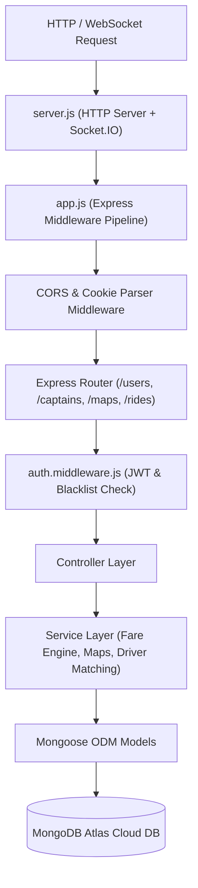

# OPERs Backend API & Engine Documentation

## 1. Overview
The **OPERs** backend is built on **Node.js** and **Express.js** using a Model-View-Controller (MVC) and service-layer architectural pattern. It exposes RESTful HTTP endpoints for riders, captains, maps, and trip management, alongside a low-latency WebSockets server (`socket.io`) for real-time dispatch and location tracking.

---

## 2. Server Architecture



---

## 3. Database Models & Schema Specifications

### User Schema (`user.model.js`)
- `fullname`: `{ firstname: String (required, min 3), lastname: String }`
- `email`: `String (required, unique, min 5)`
- `password`: `String (select: false)`
- `googleId`: `String`
- `socketId`: `String`

### Captain Schema (`captain.model.js`)
- `fullname`: `{ firstname: String (required, min 3), lastname: String }`
- `email`: `String (required, unique)`
- `password`: `String (select: false)`
- `googleId`: `String`
- `socketId`: `String`
- `status`: `Enum ['active', 'inactive'] (default: 'inactive')`
- `vehicle`: `{ color: String, plate: String, capacity: Number, vehicleType: Enum ['car', 'motorcycle', 'moto', 'auto'] }`
- `location`: `{ ltd: Number, lng: Number }`

### Ride Schema (`ride.model.js`)
- `user`: `ObjectId (Ref: user, required)`
- `captain`: `ObjectId (Ref: captain)`
- `pickup`: `String (required)`
- `destination`: `String (required)`
- `fare`: `Number (required)`
- `status`: `Enum ['pending', 'accepted', 'ongoing', 'completed', 'cancelled'] (default: 'pending')`
- `duration`: `Number`
- `distance`: `Number`
- `otp`: `String (select: false, length: 6)`

---

## 4. API Reference

### Rider Authentication (`/users`)

#### 1. Register Rider
- **Endpoint**: `POST /users/register`
- **Request Body**:
  ```json
  {
    "fullname": { "firstname": "John", "lastname": "Doe" },
    "email": "john@example.com",
    "password": "password123"
  }
  ```
- **Response** (`201 Created`):
  ```json
  {
    "token": "eyJhbGciOiJIUzI1Ni...",
    "user": { "_id": "67...", "email": "john@example.com" }
  }
  ```

#### 2. Login Rider
- **Endpoint**: `POST /users/login`
- **Request Body**: `{ "email": "john@example.com", "password": "password123" }`
- **Response** (`200 OK`): `{ "token": "...", "user": { ... } }`

#### 3. Google OAuth Login
- **Endpoint**: `POST /users/google-login`
- **Request Body**: `{ "credential": "...", "email": "john@gmail.com", "firstname": "John" }`
- **Response** (`200 OK`): `{ "token": "...", "user": { ... } }`

---

### Trip Execution (`/rides`)

#### 1. Calculate Fare
- **Endpoint**: `GET /rides/get-fare?pickup=OriginAddress&destination=DestAddress`
- **Headers**: `Authorization: Bearer <token>`
- **Response** (`200 OK`):
  ```json
  {
    "auto": 120,
    "car": 250,
    "moto": 90
  }
  ```

#### 2. Create Ride Request
- **Endpoint**: `POST /rides/create`
- **Headers**: `Authorization: Bearer <token>`
- **Request Body**: `{ "pickup": "Manas Garden", "destination": "Charbagh", "vehicleType": "car" }`
- **Response** (`201 Created`): Ride Document Object

#### 3. Confirm Ride (Captain)
- **Endpoint**: `POST /rides/confirm`
- **Headers**: `Authorization: Bearer <captain_token>`
- **Request Body**: `{ "rideId": "67..." }`
- **Response** (`200 OK`): Updated Ride Document Object

#### 4. Start Ride with OTP (Captain)
- **Endpoint**: `GET /rides/start-ride?rideId=67...&otp=123456`
- **Headers**: `Authorization: Bearer <captain_token>`
- **Response** (`200 OK`): Updated Ride Document Object (Status: `ongoing`)

#### 5. End Ride (Captain)
- **Endpoint**: `POST /rides/end-ride`
- **Headers**: `Authorization: Bearer <captain_token>`
- **Request Body**: `{ "rideId": "67..." }`
- **Response** (`200 OK`): Updated Ride Document Object (Status: `completed`)

---

## 5. Security & Verification Engine
- **Password Protection**: Passwords hashed using bcrypt with salt rounds.
- **JWT Authorization**: Stateless JWT verification checked against blacklisted token collection (`blackListTokenModel`) on logout.
- **Google OAuth Verification**: Google ID tokens validated via server-side `OAuth2Client` in `google-auth-library`.
- **Validation Rules**: All inputs validated using `express-validator` middleware rules prior to controller execution.
