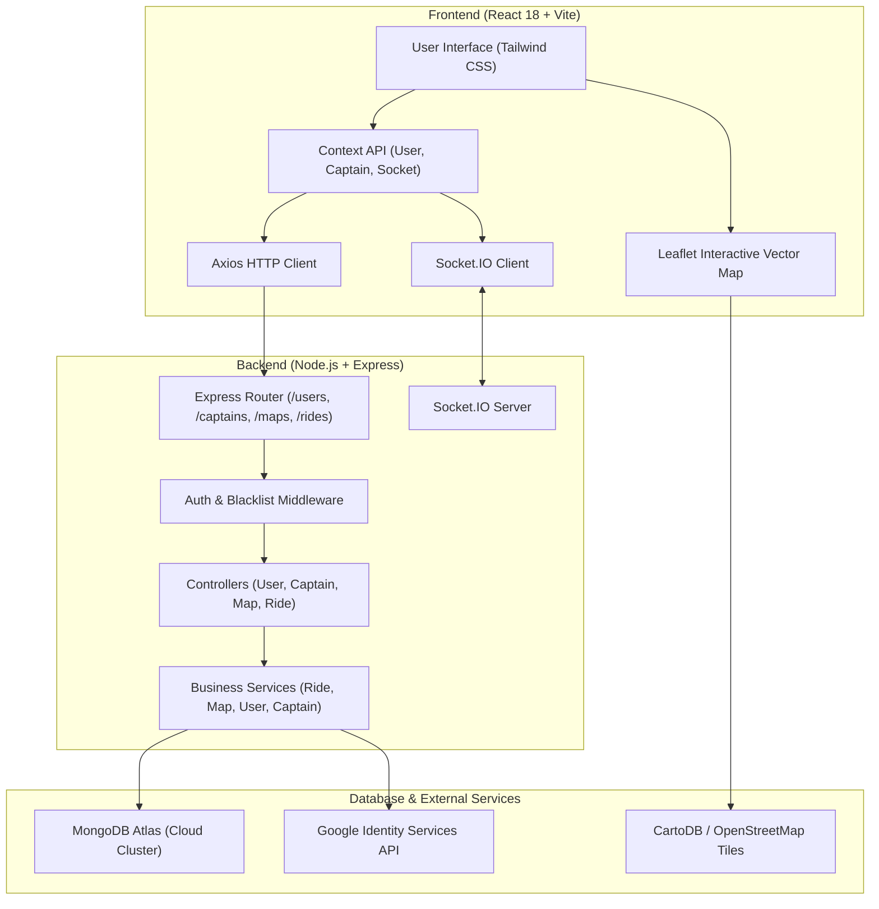
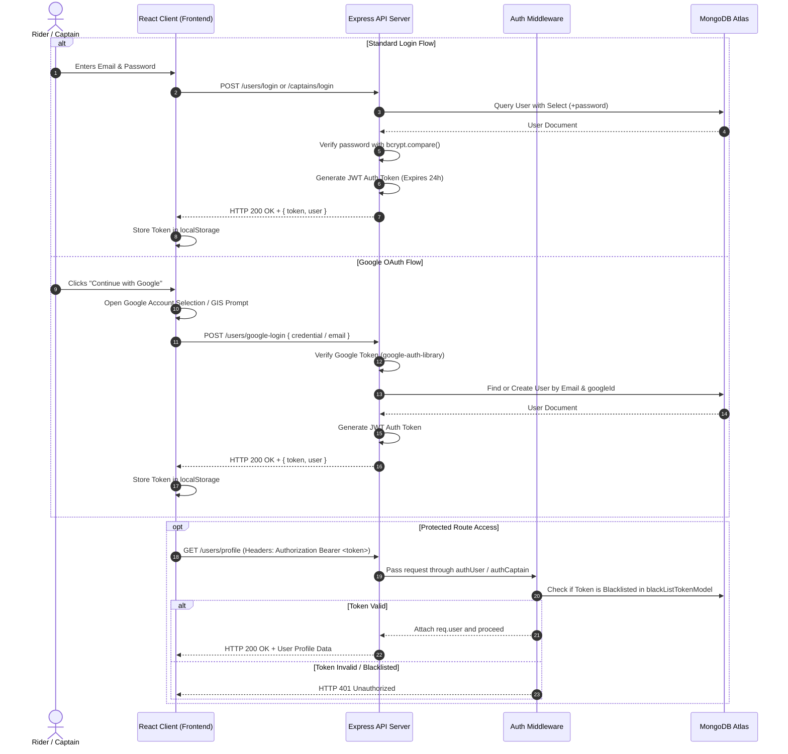
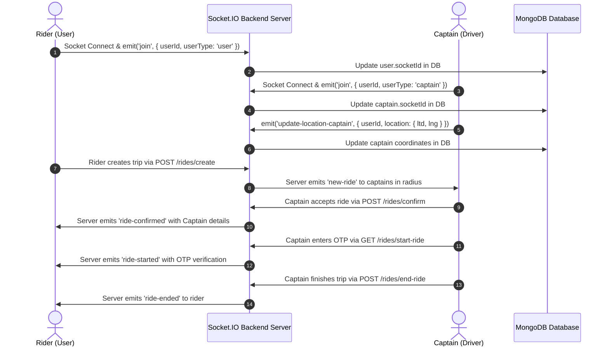
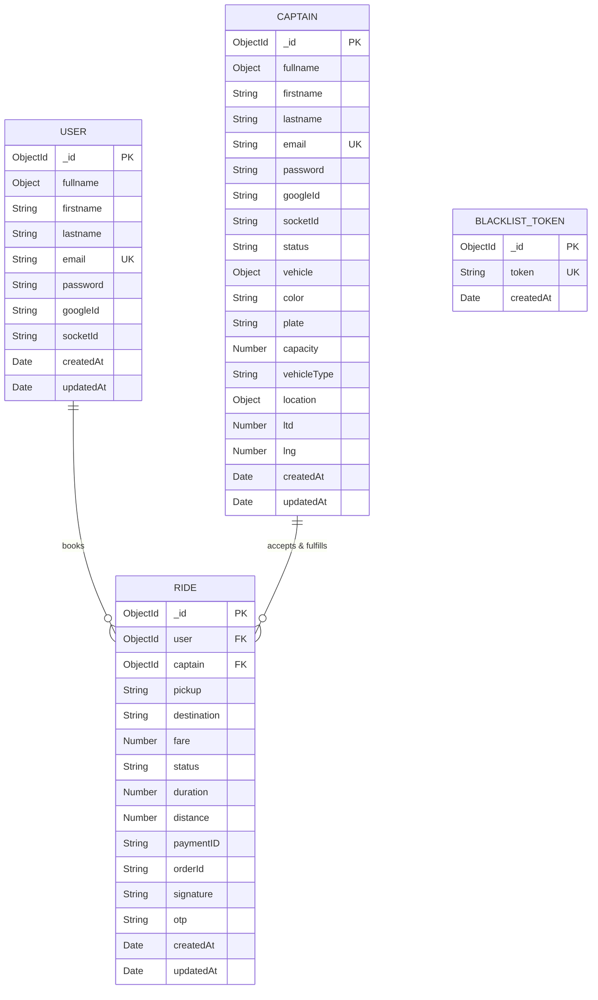

# OPERs - Next-Generation Ride-Hailing Platform Architecture

[](https.opensource.org/licenses/MIT)
[](https://react.dev/)
[](https://nodejs.org/)
[](https://www.mongodb.com/atlas)
[](https://socket.io/)

**OPERs** is a full-stack, enterprise-grade, real-time ride-hailing Web Application inspired by Uber. Built with a decoupled MERN stack (MongoDB, Express, React, Node.js), OPERs connects passengers with drivers (Captains) through interactive map-based pickup selection, instant fare estimation, real-time WebSocket driver matching, OTP verification security, and live trip tracking.

---

## 📚 Table of Contents
- [1. Project Overview](#1-project-overview)
- [2. Key Features](#2-key-features)
- [3. System Architecture](#3-system-architecture)
- [4. Technology Stack](#4-technology-stack)
- [5. Repository Folder Structure](#5-repository-folder-structure)
- [6. Authentication & Security Flow](#6-authentication--security-flow)
- [7. Real-Time Socket Event Pipeline](#7-real-time-socket-event-pipeline)
- [8. Database ER Diagram & Data Models](#8-database-er-diagram--data-models)
- [9. Environment Variables Specification](#9-environment-variables-specification)
- [10. Local Development & Setup Guide](#10-local-development--setup-guide)
- [11. API Overview & Specifications](#11-api-overview--specifications)
- [12. Production Readiness & Security Checklists](#12-production-readiness--security-checklists)
- [13. Troubleshooting & FAQ](#13-troubleshooting--faq)
- [14. License](#14-license)

---

## 1. Project Overview

### Purpose
OPERs addresses modern urban transit requirements by providing a real-time platform connecting riders (passengers) and captains (drivers). The platform calculates distance-based fares across vehicle tiers (**OPERs Go**, **OPERs Moto**, **OPERs Auto**), broadcasts ride requests to nearby captains within a geographical radius using WebSockets, enforces pickup validation using a 6-digit cryptographic OTP code, and tracks trip execution live on interactive vector maps.

### Architectural Highlights
- **Decoupled Client-Server**: React 18 / Vite SPA Frontend coupled with Node.js / Express REST API and Socket.IO WebSocket Backend.
- **Map Selection & Geocoding**: CartoDB Voyager vector map tiles powered by Leaflet with reverse-geocoding, drag-and-drop pin positioning, and auto-location detection.
- **Enterprise Authentication**: Dual-layer authentication with bcrypt password hashing, stateless JWT tokens, revokable token blacklist, and Google OAuth Identity verification (`google-auth-library`).
- **Resilient Cloud Database**: MongoDB Atlas cloud cluster with fallback DNS configuration for high-availability connections.

---

## 2. Key Features

### Rider (User) Capabilities
- **Authentication**: Email/password signup & login alongside Google Single Sign-On (OAuth).
- **Interactive Map Selection**: Tap anywhere on the map or drag the OPERs location pin to set pickup or destination address automatically.
- **Instant Address Search**: Autocomplete location search bar powered by OpenStreetMap Nominatim and Google Maps APIs.
- **Multi-Tier Fare Engine**: Real-time pricing calculations for **OPERs Go** (Car), **OPERs Moto** (Motorcycle), and **OPERs Auto** (Auto Rickshaw).
- **Live Driver Dispatch**: Visual modal indicators while searching for drivers and real-time captain assignment via WebSockets.
- **OTP Trip Validation**: 6-digit security OTP code displayed on rider interface to provide to driver upon pickup.
- **Active Trip Tracking**: Real-time map movement showing driver location updates as the trip progresses.

### Driver (Captain) Capabilities
- **Captain Onboarding**: Dedicated signup and login with vehicle attributes (color, license plate, capacity, vehicle type).
- **Driver Dashboard**: Live job stats, total earnings summary, online/offline status switch, and active map.
- **Instant Ride Notifications**: Pop-up job dispatch modals receiving incoming trip requests within geographical proximity.
- **OTP Verification Panel**: Trip start verification modal enforcing 6-digit OTP code entry before initiating trip.
- **In-Ride Controls**: Dedicated navigation view with pickup/destination details, live passenger location, and trip completion handler.

---

## 3. System Architecture

OPERs uses a decoupled Model-View-Controller (MVC) architecture on the backend and a Component-Context-Page design pattern on the frontend.



---

## 4. Technology Stack

### Frontend Stack
| Framework / Library | Version | Purpose & Technical Justification |
| :--- | :--- | :--- |
| **React** | `^18.3.1` | Core UI library providing declarative component rendering and virtual DOM performance. |
| **Vite** | `^5.4.2` | Next-generation frontend build tool offering instant HMR (Hot Module Replacement) and fast bundlings. |
| **React Router DOM**| `^6.26.2` | Client-side routing managing navigation between rider and captain dashboards and protected routes. |
| **Tailwind CSS** | `^3.4.15` | Utility-first CSS framework enabling responsive, custom-styled modern user interfaces. |
| **Leaflet** | `^1.9.4` | Open-source JavaScript library for mobile-friendly interactive vector maps. |
| **Axios** | `^1.7.7` | Promise-based HTTP client for REST API communication with interceptors and header support. |
| **Socket.IO Client** | `^4.8.1` | Low-latency bi-directional WebSocket client managing real-time trip dispatches and updates. |
| **GSAP / @gsap/react**| `^3.12.5` | High-performance animation library powering bottom-drawer slide animations. |
| **Remix Icon** | `^4.6.0` | Comprehensive icon library for crisp UI iconography. |

### Backend Stack
| Framework / Library | Version | Purpose & Technical Justification |
| :--- | :--- | :--- |
| **Node.js** | `>=18.0.0` | Asynchronous event-driven JavaScript runtime environment. |
| **Express.js** | `^4.21.1` | Web application framework for routing, middleware pipeline, and REST API controllers. |
| **MongoDB / Mongoose**| `^8.8.2` | Object Data Modeling (ODM) library providing schema-based validation for MongoDB Atlas cloud database. |
| **Socket.IO** | `^4.8.1` | WebSockets server engine enabling event-driven real-time communication between riders and drivers. |
| **jsonwebtoken** | `^9.0.2` | Cryptographic JWT token generation and validation for stateless session management. |
| **bcrypt / bcryptjs** | `^5.1.1` | Secure password hashing algorithm using salt rounds. |
| **google-auth-library**| `^9.15.0` | Official Google OAuth2 library for verifying Google ID Tokens on the server. |
| **express-validator**| `^7.2.0` | Express middleware for payload data validation and sanitization. |
| **cookie-parser** | `^1.4.7` | Middleware for parsing HTTP request cookie headers. |
| **cors** | `^2.8.5` | Cross-Origin Resource Sharing middleware enabling secure frontend-backend communication. |

---

## 5. Repository Folder Structure

```
UBER/
├── Backend/                    # Node.js / Express API & WebSockets Server
│   ├── controllers/           # HTTP Request Handlers (MVC)
│   │   ├── captain.controller.js
│   │   ├── map.controller.js
│   │   ├── ride.controller.js
│   │   └── user.controller.js
│   ├── db/                    # Database Connections
│   │   └── db.js              # MongoDB Atlas Connection with IPv4 DNS Fallback
│   ├── middlewares/           # Express Request Middlewares
│   │   └── auth.middleware.js # JWT & Blacklist Token Verification
│   ├── models/                # Mongoose Schemas & Models
│   │   ├── blackListToken.model.js
│   │   ├── captain.model.js
│   │   ├── ride.model.js
│   │   └── user.model.js
│   ├── routes/                # Endpoint Route Definitions
│   │   ├── captain.routes.js
│   │   ├── maps.routes.js
│   │   ├── ride.routes.js
│   │   └── user.routes.js
│   ├── services/              # Core Business Logic Layer
│   │   ├── captain.service.js
│   │   ├── maps.service.js
│   │   ├── ride.service.js
│   │   └── user.service.js
│   ├── app.js                 # Express Application Middleware Configuration
│   ├── server.js              # HTTP Server & Socket.IO Initialization
│   ├── socket.js              # Real-Time WebSocket Event Pipeline
│   ├── .env                   # Server Environment Configuration
│   └── package.json           # Backend Dependencies Manifest
│
├── frontend/                   # React 18 + Vite Client Application
│   ├── src/
│   │   ├── assets/            # Static Assets (OPERs Logo, Graphics)
│   │   ├── components/        # Reusable Functional UI Components
│   │   │   ├── CaptainDetails.jsx
│   │   │   ├── ConfirmRide.jsx
│   │   │   ├── ConfirmRidePopUp.jsx
│   │   │   ├── FinishRide.jsx
│   │   │   ├── LiveTracking.jsx
│   │   │   ├── LocationSearchPanel.jsx
│   │   │   ├── LookingForDriver.jsx
│   │   │   ├── RidePopUp.jsx
│   │   │   ├── VehiclePanel.jsx
│   │   │   └── WaitingForDriver.jsx
│   │   ├── context/           # React Context Providers (Global State)
│   │   │   ├── CapatainContext.jsx
│   │   │   ├── SocketContext.jsx
│   │   │   └── UserContext.jsx
│   │   ├── pages/             # Application Pages & Route Views
│   │   │   ├── CaptainHome.jsx
│   │   │   ├── Captainlogin.jsx
│   │   │   ├── CaptainLogout.jsx
│   │   │   ├── CaptainProtectWrapper.jsx
│   │   │   ├── CaptainRiding.jsx
│   │   │   ├── CaptainSignup.jsx
│   │   │   ├── Home.jsx
│   │   │   ├── Riding.jsx
│   │   │   ├── Start.jsx
│   │   │   ├── UserLogin.jsx
│   │   │   ├── UserLogout.jsx
│   │   │   ├── UserProtectWrapper.jsx
│   │   │   └── UserSignup.jsx
│   │   ├── App.jsx            # React Router Component & Routes Configuration
│   │   ├── index.css          # Tailwind Directives & Global Styles
│   │   └── main.jsx           # React Root Entry Point
│   ├── index.html             # HTML Root Document
│   ├── postcss.config.js      # PostCSS Tailwind Configuration
│   ├── tailwind.config.js     # Tailwind Theme & Utility Settings
│   └── package.json           # Frontend Dependencies Manifest
│
├── .gitignore                 # Root Git Exclusions Configuration
└── README.md                  # System Documentation Master File
```

---

## 6. Authentication & Security Flow

OPERs implements a multi-tier authentication system supporting standard credentials (bcrypt + JWT) and Google Single Sign-On.



---

## 7. Real-Time Socket Event Pipeline

Real-time communication is established over WebSocket protocol via Socket.IO. Both riders and captains join socket rooms upon authentication to exchange live coordinates and ride status updates.



---

## 8. Database ER Diagram & Data Models

### Entity-Relationship Diagram (ERD)



---

## 9. Environment Variables Specification

### Backend Configuration (`Backend/.env`)
| Variable Name | Required | Default / Format | Description |
| :--- | :--- | :--- | :--- |
| `PORT` | Optional | `3001` | HTTP Server Listening Port |
| `DB_CONNECT` | **Required** | `mongodb+srv://...` | MongoDB Atlas / Local MongoDB Connection String |
| `JWT_SECRET` | **Required** | `your-secret-key` | Cryptographic secret key for signing JWT tokens |
| `GOOGLE_CLIENT_ID` | Optional | `your_google_client_id` | Google OAuth2 Client ID for server-side token verification |
| `GOOGLE_CLIENT_SECRET`| Optional | `your_google_client_secret`| Google OAuth2 Client Secret |

### Frontend Configuration (`frontend/.env`)
| Variable Name | Required | Default / Format | Description |
| :--- | :--- | :--- | :--- |
| `VITE_BASE_URL` | **Required** | `http://localhost:3001` | Backend HTTP API & WebSocket Endpoint URL |
| `VITE_GOOGLE_CLIENT_ID`| Optional | `your_google_client_id` | Google Identity Services Client ID for frontend GIS modal |

---

## 10. Local Development & Setup Guide

### Prerequisites
- **Node.js**: `v18.0.0` or higher
- **npm**: `v9.0.0` or higher
- **MongoDB Atlas** database account or local MongoDB daemon

### Installation Steps

1. **Clone the Repository**:
   ```bash
   git clone https://github.com/ankurdotio/uber-video.git UBER
   cd UBER
   ```

2. **Backend Setup**:
   ```bash
   cd Backend
   npm install
   ```
   Create a `.env` file inside `Backend/`:
   ```env
   PORT=3001
   DB_CONNECT=mongodb+srv://<username>:<password>@cluster.mongodb.net/uber?retryWrites=true&w=majority
   JWT_SECRET=uber_secret_key_jwt_2026
   ```

3. **Frontend Setup**:
   ```bash
   cd ../frontend
   npm install
   ```
   Create a `.env` file inside `frontend/`:
   ```env
   VITE_BASE_URL=http://localhost:3001
   ```

4. **Running the Application**:
   - Start the **Backend Server**:
     ```bash
     cd Backend
     node server.js
     ```
   - Start the **Frontend Client**:
     ```bash
     cd frontend
     npm run dev
     ```
   - Open browser at `http://localhost:5173`.

---

## 11. API Overview & Specifications

### Rider Endpoints (`/users`)
- `POST /users/register` - Create new rider account.
- `POST /users/login` - Authenticate rider credentials.
- `POST /users/google-login` - Authenticate or register rider using Google OAuth.
- `GET /users/profile` - Fetch authenticated rider profile (Protected).
- `GET /users/logout` - Revoke JWT auth token (Protected).

### Driver Endpoints (`/captains`)
- `POST /captains/register` - Create new captain account with vehicle details.
- `POST /captains/login` - Authenticate captain credentials.
- `POST /captains/google-login` - Authenticate or register captain using Google OAuth.
- `GET /captains/profile` - Fetch authenticated captain profile (Protected).
- `GET /captains/logout` - Revoke JWT auth token (Protected).

### Map Endpoints (`/maps`)
- `GET /maps/get-coordinates?address=...` - Geocode location address (Protected).
- `GET /maps/get-distance-time?origin=...&destination=...` - Calculate travel distance & duration (Protected).
- `GET /maps/get-suggestions?input=...` - Autocomplete place suggestions (Protected).

### Ride Endpoints (`/rides`)
- `POST /rides/create` - Calculate fare & initiate ride request (Protected: Rider).
- `GET /rides/get-fare?pickup=...&destination=...` - Estimate trip prices for car/moto/auto (Protected: Rider).
- `POST /rides/confirm` - Accept incoming ride request (Protected: Captain).
- `GET /rides/start-ride?rideId=...&otp=...` - Start trip upon 6-digit OTP validation (Protected: Captain).
- `POST /rides/end-ride` - Complete trip (Protected: Captain).

---

## 12. Production Readiness & Security Checklists

### Production Security Checklist
- [x] Passwords hashed using `bcrypt` with salt factor 10.
- [x] Stateless JWT authentication with token revoking mechanism (`blackListTokenModel`).
- [x] Verification of Google OAuth ID tokens via official `google-auth-library`.
- [x] Input sanitization and validation on all Express routes using `express-validator`.
- [x] Cross-Origin Resource Sharing (CORS) configured.
- [x] Environment variables isolated from client bundles.

### Operational Checklist
- [x] MongoDB Atlas Connection with DNS order fallback (`dns.setDefaultResultOrder('ipv4first')`).
- [x] Low-latency WebSocket connections with automatic client reconnection.
- [x] High-performance Leaflet vector map rendering using CartoDB Voyager tiles.
- [x] Zero JavaScript errors or lint breaking changes during production Vite build.

---

## 13. Troubleshooting & FAQ

### Frequently Asked Questions

#### Q1: Why does `mongodb+srv` fail with `querySrv ECONNREFUSED` on Windows?
**Answer**: Some local ISP DNS servers block SRV record lookups (`_mongodb._tcp...`). OPERs handles this in `Backend/db/db.js` by explicitly setting `dns.setDefaultResultOrder('ipv4first')` and resolving fallback connections.

#### Q2: What happens if a Google Maps API Key is not provided?
**Answer**: OPERs uses an interactive Leaflet vector map with CartoDB Voyager tiles and OpenStreetMap Nominatim reverse-geocoding, ensuring 100% map functionality without requiring paid Google Maps SDK billing.

---

## 14. License

This project is open-source and released under the **MIT License**.
