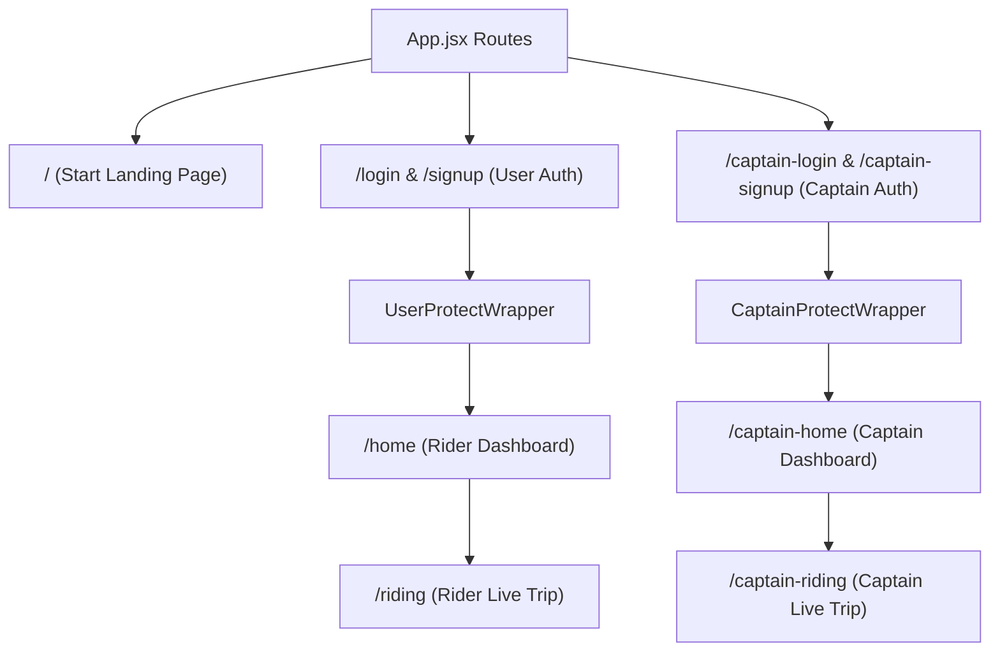

# OPERs Frontend Technical Documentation

## 1. Overview
The **OPERs** frontend application is a modern Single Page Application (SPA) built using **React 18** and **Vite**. It provides responsive user interfaces for both Passengers (Riders) and Drivers (Captains).

### Responsibilities
- **Rider Workflow**: Location pickup selection on vector maps, address autocomplete search, instant multi-vehicle fare estimation (**OPERs Go**, **OPERs Moto**, **OPERs Auto**), driver matching animation, and live ride status.
- **Captain Workflow**: Online/offline availability toggle, incoming trip request notification popups, OTP validation before trip start, and active trip navigation.
- **Real-Time Integration**: Seamless WebSocket event pipeline with `socket.io-client` for real-time driver tracking and status broadcasts.

---

## 2. Technology Stack

| Library | Version | Purpose & Technical Rationale |
| :--- | :--- | :--- |
| **React** | `^18.3.1` | UI component tree management with virtual DOM diffing. |
| **Vite** | `^5.4.2` | Fast development server and production bundler. |
| **React Router DOM** | `^6.26.2` | Client-side routing, page navigation, and route guards. |
| **Tailwind CSS** | `^3.4.15` | Utility-first styling framework for responsive web design. |
| **Leaflet** | `^1.9.4` | High-performance interactive map engine with vector tiles. |
| **Axios** | `^1.7.7` | HTTP client for REST API communication. |
| **Socket.IO Client** | `^4.8.1` | Low-latency WebSockets client for real-time trip events. |
| **GSAP** | `^3.12.5` | Animation engine powering drawer transitions. |

---

## 3. Folder Structure

```
frontend/src/
├── assets/          # Static branding assets (OPERs logo, icons)
├── components/      # Modular UI components
│   ├── CaptainDetails.jsx       # Driver earnings and status card
│   ├── ConfirmRide.jsx          # Trip fare confirmation modal
│   ├── ConfirmRidePopUp.jsx     # Driver OTP trip start panel
│   ├── FinishRide.jsx           # Driver trip completion modal
│   ├── LiveTracking.jsx         # Leaflet interactive map component
│   ├── LocationSearchPanel.jsx  # Address autocomplete dropdown
│   ├── LookingForDriver.jsx     # Driver search animation panel
│   ├── RidePopUp.jsx            # Driver incoming request popup
│   ├── VehiclePanel.jsx         # Vehicle tier selection list
│   └── WaitingForDriver.jsx     # Rider matched driver view
├── context/         # React Context state management
│   ├── CapatainContext.jsx     # Captain profile and vehicle state
│   ├── SocketContext.jsx       # WebSocket connection instance
│   └── UserContext.jsx         # Rider profile state
├── pages/           # Page routes
│   ├── CaptainHome.jsx         # Driver dashboard
│   ├── Captainlogin.jsx        # Driver login page
│   ├── CaptainLogout.jsx       # Driver logout handler
│   ├── CaptainProtectWrapper.jsx # Driver route guard
│   ├── CaptainRiding.jsx       # Driver active trip view
│   ├── CaptainSignup.jsx       # Driver registration page
│   ├── Home.jsx                # Rider dashboard
│   ├── Riding.jsx              # Rider active trip view
│   ├── Start.jsx               # Landing page
│   ├── UserLogin.jsx           # Rider login page
│   ├── UserLogout.jsx          # Rider logout handler
│   ├── UserProtectWrapper.jsx  # Rider route guard
│   └── UserSignup.jsx          # Rider registration page
├── App.jsx          # Application route definitions
├── index.css        # Tailwind directives and custom CSS
└── main.jsx         # Application entry point
```

---

## 4. Component Specifications

### `LiveTracking.jsx`
- **Purpose**: Renders the interactive Leaflet vector map with CartoDB Voyager tiles.
- **Props**: `onLocationSelect` (Callback function), `activeField` (String: `'pickup'` | `'destination'`).
- **Features**: Map click location selection, draggable OPERs pin, Nominatim reverse-geocoding, and "Locate Me" GPS control.

### `VehiclePanel.jsx`
- **Purpose**: Displays available vehicle tiers and real-time calculated trip fares.
- **Props**: `fare` (Object containing `{ car, moto, auto }`), `selectVehicle` (Function), `setConfirmRidePanel` (Function).

### `RidePopUp.jsx`
- **Purpose**: Renders incoming trip dispatch notifications to online captains.
- **Props**: `ride` (Object), `setRidePopupPanel` (Function), `setConfirmRidePopupPanel` (Function), `confirmRide` (Function).

### `ConfirmRidePopUp.jsx`
- **Purpose**: Enforces 6-digit OTP code entry by captain to initiate a trip.
- **Props**: `ride` (Object), `setConfirmRidePopupPanel` (Function), `setRidePopupPanel` (Function).

---

## 5. Client Routing Architecture



---

## 6. Real-Time Socket Events Table

| Event Name | Direction | Payload Structure | Action |
| :--- | :--- | :--- | :--- |
| `join` | Client ➔ Server | `{ userId: string, userType: 'user' \| 'captain' }` | Register socket ID in database. |
| `update-location-captain` | Client ➔ Server | `{ userId: string, location: { ltd: number, lng: number } }` | Broadcast captain coordinates. |
| `new-ride` | Server ➔ Client | Ride Document Object | Alert captains in radius of new trip. |
| `ride-confirmed` | Server ➔ Client | Ride Document Object with Captain details | Alert rider of accepted trip. |
| `ride-started` | Server ➔ Client | Ride Document Object | Transition rider to `/riding` view. |
| `ride-ended` | Server ➔ Client | Ride Document Object | Complete trip and return to home. |

---

## 7. Performance & Security Best Practices
- **Token Security**: Tokens stored securely in `localStorage` and sent via HTTP Bearer Authorization headers.
- **Responsive Layout**: Designed with Tailwind flexbox and grid utilities supporting mobile, tablet, and desktop viewports.
- **Optimized Assets**: Assets bundled via Vite with CSS minification and vector icon optimization.
